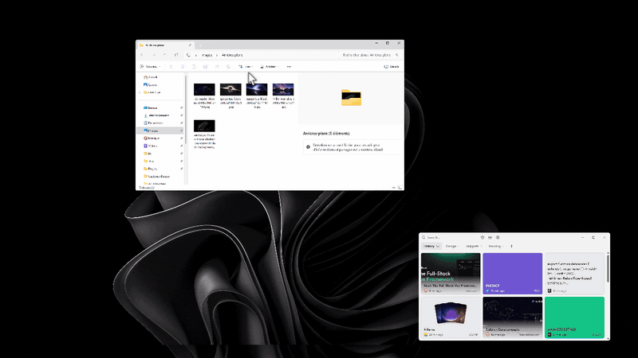
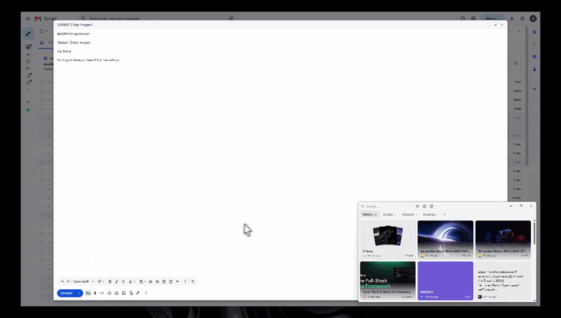
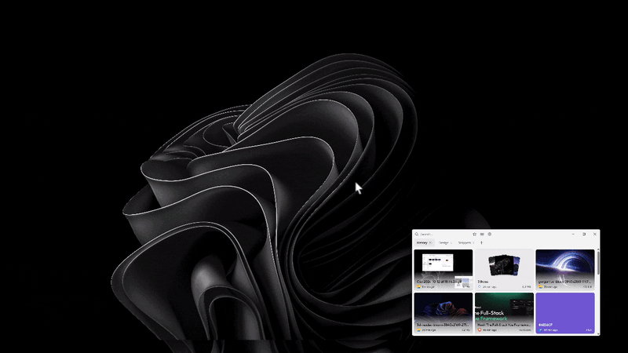
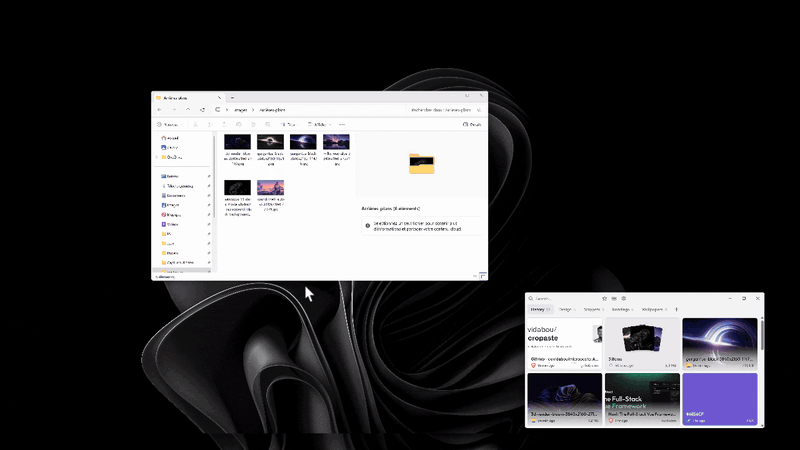

<div align="center">


# Micropaste

**Your clipboard, but you can actually see it.**

A visual clipboard library for Windows 11. Everything you copy is kept, previewed as a rich card,<br>
and ready to reuse in a single click or drag.

[](https://github.com/davidabou/micropaste/actions/workflows/app.yml)


<br>



</div>

---

## Why Micropaste?

You copy dozens of things a day: a link, a hex code, a screenshot, a few lines of code, a folder of files.
Win+V forgets most of them and shows them as a plain list. Micropaste keeps them all and turns them into a
library you can browse, search and organize.

It is **local-first**: your clips are stored only on your computer. No account, no cloud, no telemetry.

## Features

### 🖼️ Every copy becomes a card

Micropaste recognizes what you copied and shows it the way it deserves:

- **Text and code**, with word, line and character counts in the details panel
- **Links**, with a preview of the page title and image
- **Images and screenshots**, shown in full
- **Colors**: hex (with or without `#`), `rgb()`, `hsl()`, `oklch()` and more, displayed as a swatch
- **SVG** markup, rendered as the actual graphic
- **Files and folders**, with their real Windows thumbnails. A group of files fans out like a hand of cards

Each card shows the app it was copied from and when.

### ⚡ Reuse in one gesture

- **Click** a card to copy it back to the clipboard.
- **Drag** a card straight into any app: text, images and files drop where you need them.
- **Right-click** for the full menu: copy, details, favorite, add to collections, delete.



### 🗂️ Collections

Group clips into your own collections, shown as tabs next to your history.

- Drag a card onto a tab to file it there, and drag cards around to reorder them.
- Drag tabs to reorder your collections, rename them or delete them from their menu.
- Drop files, text or pictures **from other apps** straight into a collection.
- Clips in a collection are kept forever.



### ⭐ Favorites and search

- Star the clips you use all the time, then show only your favorites in one click.
- **Ctrl+F** searches through everything, including the titles of link previews.



### 🔍 Details panel

Open any clip to see a large preview, the source app, the date, dimensions and size.
File groups get a carousel you can browse with the arrow keys.

### 🪟 Feels at home on Windows 11

- Native look: Mica background, Windows 11 tooltips, smooth spring animations, light and dark themes.
- Lives quietly in the **system tray**: closing the window just hides it, and it can start with Windows.
- Grid or list layout, your choice.

### 🧹 Tidy by itself

Clips you haven't used in **30 days** are cleaned up automatically: choose anything from 1 day to forever in the settings.
Favorites and clips in collections are never touched.

## Installation

Download `Micropaste_x.y.z_x64-setup.exe` and run it.

> [!NOTE]
> The installer isn't signed yet, so Windows SmartScreen may warn you. Click **More info**, then **Run anyway**.

Your data is stored locally in `%APPDATA%\com.abou.micropaste`.

## Keyboard shortcuts

| Shortcut | Action |
| --- | --- |
| <kbd>Alt</kbd> + <kbd>Shift</kbd> + <kbd>V</kbd> | Show Micropaste from anywhere, or hide it (can be changed in the settings) |
| <kbd>Ctrl</kbd> + <kbd>F</kbd> | Search |
| <kbd>Esc</kbd> | Clear the search, close a panel or a confirmation |
| <kbd>←</kbd> <kbd>→</kbd> | Browse the files of a group in the details panel |

## Building from source

**Requirements:** [Bun](https://bun.sh), [Rust](https://rustup.rs) and the [Tauri prerequisites for Windows](https://tauri.app/start/prerequisites/).

```bash
# Install dependencies
bun install

# Run in development
bun run tauri dev

# Build the installer
bun run tauri build
```

The installer ends up in `src-tauri/target/release/bundle/nsis/`.

## Built with

- [Tauri 2](https://tauri.app) and Rust for the native side: clipboard watching, SQLite storage, drag and drop, tray
- [Nuxt 4](https://nuxt.com) and [Vue](https://vuejs.org) for the interface
- [Tailwind CSS v4](https://tailwindcss.com), [Reka UI](https://reka-ui.com) and [Motion](https://motion.dev)
- [Gravity UI icons](https://gravity-ui.com/icons)

---

<div align="center">

Made for people who copy a lot. 📋

</div>
